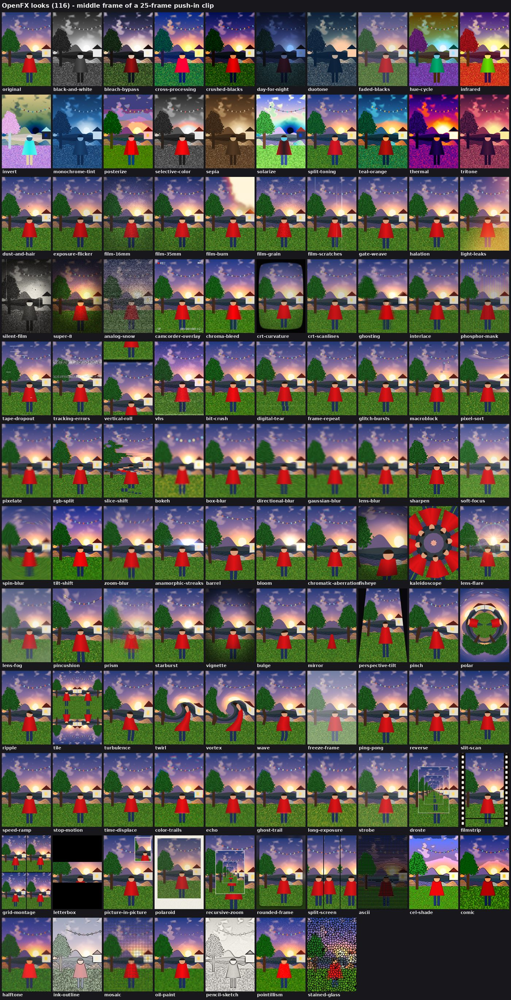

# OpenFX

**Hundreds of video effects, fully open source.** Upload a photo or video, pick an AI effect (disintegrate, set on fire, turn to stone, hologram...) and stack up to four Looks (VHS, Super 8, teal & orange, glitch, halftone...), and get a short video ready to share.

OpenFX is an open rebuild of the closed "effects" apps on commercial AI video platforms. It runs on open-weights models (LTX video) through ComfyUI, on your own GPU, for free.

Built for the [Open Source Higgsfield](https://comfy.org/open-source-higgsfield) challenge. #OpenSourceHiggsfield

## What makes it different: effects are files, not features

Every effect is a folder with one `manifest.json`:

```json
{
  "name": "Disintegrate",
  "description": "The subject crumbles into drifting dust and blows away.",
  "workflow": "workflows/ltx23_i2v_api.json",
  "prompt": "The subject{detail} slowly disintegrates into thousands of tiny glowing ash particles...",
  "defaults": { "width": 512, "height": 768, "seconds": 4 }
}
```

To add an effect, copy a folder under `effects/`, change the prompt and settings, and restart. It appears in the app. To create a whole new kind of effect, export any ComfyUI workflow in API format into `workflows/`, add a `*.bindings.json` that says which node takes the image, prompt and size, and point a manifest at it. Pull requests with new effects are welcome.

## Two kinds of effect

- **AI effects** generate new motion and content with LTX-2.3 image-to-video (fire, disintegration, materials, sci-fi). About 1-2 minutes per clip on a 12 GB card.
- **Looks** are 116 exact, deterministic filters from our ComfyUI node pack, [`comfyui_openfx`](comfyui_openfx/): color grades, film stocks, VHS and CRT, glitch, lens, blur, distortion, time and trails, layouts and art styles. They take seconds, stack on top of AI effects, and also work on your own videos.



## How it works

```
Browser ──> OpenFX server (FastAPI) ──Comfy SDK──> Comfy API proxy ──> ComfyUI + LTX on your GPU
```

- **ComfyUI** runs the LTX-2.3 image-to-video workflow (open weights).
- **Comfy SDK** (`comfy-sdk`) submits the workflow, uploads the photo and downloads the video. It talks to the **Comfy API proxy** in front of your local ComfyUI.
- Point `COMFY_BASE_URL` at a Comfy API deployment instead (and set `COMFY_API_KEY`) to run the same app on hosted GPUs. No code changes.
- Jobs run one at a time, because one GPU renders one video at a time.

## Run it locally

You need an NVIDIA GPU with 12 GB+ of VRAM. It's tested on an RTX 5070 (12 GB): a 4-second 512x768 clip takes about 1.5 minutes.

1. **Install ComfyUI** and the LTX-2.3 image-to-video models. Use the official LTX-2.3 image-to-video template in ComfyUI's template browser, which offers to download the models. RTX 50-series cards need a PyTorch build for CUDA 12.8 or newer.
2. **Add the Look nodes:** link or copy `comfyui_openfx/` into `ComfyUI/custom_nodes/` (the Windows script does this for you).
3. **Start ComfyUI** on the default port (`http://127.0.0.1:8188`).
4. **Start OpenFX:**

   Windows:
   ```bat
   scripts\start-windows.bat
   ```

   macOS / Linux:
   ```bash
   python -m venv .venv && . .venv/bin/activate
   pip install -r requirements.txt
   comfy-api-proxy run &                   # serves the v2 API on 127.0.0.1:8189
   COMFY_BASE_URL=http://127.0.0.1:8189 python -m openfx
   ```
5. Open **http://127.0.0.1:7860**.

## Project layout

| Path | What it is |
|---|---|
| `effects/<id>/manifest.json` | One effect: prompt, defaults, base workflow |
| `workflows/*_api.json` | ComfyUI workflows in API format |
| `workflows/*.bindings.json` | Which node takes the image, prompt, width, height and length |
| `comfyui_openfx/` | ComfyUI node pack: 116 Looks, Look Stack and Still To Clip nodes |
| `openfx/` | Server, effect registry and the Comfy SDK runner |
| `web/looks.json` | Look catalog, regenerate with `python -m comfyui_openfx.catalog > web/looks.json` |
| `web/` | The web app |

## License

MIT. Models keep their own licenses: check the LTX model license before any commercial use.
